# Adding a New HENU Application: End-to-End Guide

This guide walks through the complete lifecycle of creating, building, releasing, registering, and distributing a new software application in the **HENU Operating System** ecosystem.

```mermaid
flowchart LR
    A["1. Create GitHub Repo"] --> B["2. Add Common Actions Workflow"]
    B --> C["3. Register in HENU Admin"]
    C --> D["4. Connect Repo & Webhook"]
    D --> E["5. Tag & Push Release (v1.0.0)"]
    E --> F["6. CI/CD Build & Attest"]
    F --> G["7. Platform API Webhook Ingest"]
    G --> H["8. Admin Approval & Catalogue Publish"]
    H --> I["9. Instant Discovery in HENU HUB"]
```



---

## Prerequisites

Before beginning, ensure you have:

1. Administrator access to the **HENU Admin Panel** (`http://localhost:3001` or production URL).
2. Write access to the **HENU GitHub Organization** (`https://github.com/henu-os`).
3. Node.js LTS and your application's native build tools installed locally.

---

## Step 1: Create the Product GitHub Repository

1. Create a new repository under the `henu-os` organization using kebab-case naming:
   - Example: `https://github.com/henu-os/henu-pa`
2. Follow standard project structure:
   ```
   henu-pa/
   ├── .github/
   │   └── workflows/
   │       └── release.yml         <-- Reusable release workflow invocation
   ├── assets/
   │   └── icon.png               <-- 512x512 PNG application icon
   ├── src/                       <-- Application source code
   ├── package.json               <-- Project manifest & build scripts
   └── README.md
   ```
3. Define build scripts in `package.json` that output binary installers for target platforms:
   ```json
   {
     "name": "henu-pa",
     "version": "1.0.0",
     "scripts": {
       "build:msi": "tauri build --bundles msi",
       "build:dmg": "tauri build --bundles dmg",
       "build:appimage": "tauri build --bundles appimage"
     }
   }
   ```

---

## Step 2: Configure the Reusable Release Workflow

In your product repository, create `.github/workflows/release.yml`. Call the centralized **HENU Release Orchestrator** from `henu-common-actions`:

```yaml
name: 'Release HENU PA'

on:
  push:
    tags:
      - 'v*.*.*'
  workflow_dispatch:
    inputs:
      version:
        description: 'Semantic version (e.g. 1.0.0)'
        required: true
        type: string
      channel:
        description: 'Target release channel'
        required: true
        type: choice
        options: [stable, beta, nightly]
        default: stable
      release-notes:
        description: 'Release changelog notes in Markdown'
        required: true
        type: string

permissions:
  contents: write
  id-token: write
  attestations: write

jobs:
  release:
    uses: henu-os/henu-common-actions/.github/workflows/release-orchestrator.yml@v1
    with:
      product-id: 'henu-pa'
      product-name: 'HENU PA'
      version: ${{ inputs.version || (startsWith(github.ref, 'refs/tags/v') && format('{0}', substr(github.ref, 11)) || '1.0.0') }}
      channel: ${{ inputs.channel || (contains(github.ref, '-beta') && 'beta' || (contains(github.ref, '-nightly') && 'nightly' || 'stable')) }}
      git-tag: ${{ github.ref_name }}
      release-notes: ${{ inputs.release-notes || 'Production release of HENU PA' }}
      min-hub-version: '1.0.0'
      # Multi-Platform Build Targets
      build-windows: true
      windows-format: 'msi'
      windows-arch: 'x86_64'
      windows-build-command: 'npm run build:msi'
      build-macos: true
      macos-format: 'dmg'
      macos-arch: 'universal'
      macos-build-command: 'npm run build:dmg'
      build-linux: true
      linux-format: 'appimage'
      linux-arch: 'x86_64'
      linux-build-command: 'npm run build:appimage'
      platform-api-url: 'https://api.henuos.com/api/v1/webhooks/github'
    secrets:
      platform-webhook-secret: ${{ secrets.HENU_WEBHOOK_SECRET }}
```

> **Why this matters:** Publishing a release for `henu-pa` runs independently in its own repository and does **not** trigger or require rebuilding `henu-ai`, `henu-ide`, or `henu-hub`.

---

## Step 3: Register the Application in HENU Admin Panel

1. Log into the **HENU Admin Panel** (`http://localhost:3001/login`).
2. Navigate to **Applications &rarr; Add Application** (`/applications/add`).
3. Fill out the application registration form:
   - **Product ID**: `henu-pa` (must match GitHub configuration).
   - **Name**: `HENU PA`.
   - **Summary**: `Personal Assistant for the HENU Operating System`.
   - **Description**: Detailed markdown description of features and usage.
   - **Category**: `Productivity` (or `AI`, `Development`, `Utilities`, `Social`).
   - **Application Type**: `Native Desktop` (or `Web Application`, `CLI Tool`, `System Component`).
   - **Icon URL**: `https://raw.githubusercontent.com/henu-os/henu-pa/main/assets/icon.png`.
   - **Supported Platforms**: Check `Windows`, `macOS`, and `Linux`.
   - **Architectures**: Check `x86_64` and `arm64 / universal`.
   - **Package Formats**: Check `MSI`, `DMG`, `AppImage`.
   - **Minimum HUB Version**: `1.0.0`.
   - **Release Channels**: Check `Stable`, `Beta`, and `Nightly`.
4. Click **Create Application**.

---

## Step 4: Connect the GitHub Repository

1. In the Admin Panel, navigate to **GitHub Repositories** (`/repositories`).
2. Click **Connect Repository**:
   - **Repository Owner**: `henu-os`.
   - **Repository Name**: `henu-pa`.
   - **Bound Application**: Select `HENU PA (henu-pa)`.
   - **Release Asset Regex**: `^henu-pa-.*\\.(msi|dmg|AppImage)$`.
3. Save the connection. The webhook endpoint will be automatically provisioned for HMAC-SHA256 signature verification.

---

## Step 5: Tag and Publish the First Release

1. Commit your codebase and push all changes:
   ```bash
   git add .
   git commit -m "feat: initial implementation of HENU PA v1.0.0"
   git push origin main
   ```
2. Create and push the release Git tag:
   ```bash
   git tag -a v1.0.0 -m "Release v1.0.0: Initial production release of HENU PA"
   git push origin v1.0.0
   ```
3. GitHub Actions will trigger `release-orchestrator.yml`:
   - Validates SemVer format and channel compatibility.
   - Builds Windows `MSI`, macOS `DMG`, and Linux `AppImage`.
   - Computes streaming SHA-256 digests and outputs `SHA256SUMS`.
   - Generates cryptographic SLSA Build Attestation.
   - Publishes the GitHub Release with all binary packages attached.
   - Sends a signed webhook notification to the **HENU Platform API**.

---

## Step 6: Platform API Release Ingestion

When GitHub notifies the Platform API:

1. The **GitHubSignatureGuard** validates `X-Hub-Signature-256` using constant-time comparison against `GITHUB_WEBHOOK_SECRET`.
2. The release ingestion pipeline:
   - Validates the tag `v1.0.0` and SemVer `1.0.0`.
   - Downloads each binary asset, streaming its bytes to compute and verify the SHA-256 checksum.
   - Matches packages against the configured regex patterns.
   - Stores the release in PostgreSQL with status `PENDING_APPROVAL`.

---

## Step 7: Admin Approval & Catalogue Publishing

1. Open the Admin Panel and navigate to **Releases** (`/releases`).
2. Click on the new release `v1.0.0` for **HENU PA** (`/releases/[id]`).
3. Verify that all 3 platform packages (Windows MSI, macOS DMG, Linux AppImage) are green with validated SHA-256 digests.
4. Click **Approve Release**.
5. Navigate to **Catalogue &rarr; Publishing** (`/catalogue/publish`).
6. Review the catalogue preview containing the new application and click **Publish New Catalogue Revision**.
7. The Platform API compiles revision `N+1`, stores the immutable manifest, generates content hashes, and triggers an SSE broadcast event `catalogue:updated`.

---

## Step 8: Dynamic Discovery in HENU HUB

1. Running instances of **HENU HUB** immediately receive the `catalogue:updated` event via Server-Sent Events.
2. HENU HUB performs a conditional HTTP request with `If-None-Match`.
3. **HENU PA** appears instantly in the **App Store** view without needing to rebuild or relaunch HENU HUB!
4. Users click **Install**:
   - HENU HUB downloads the native package for their current host OS.
   - Computes and verifies the streaming SHA-256 digest against the catalogue manifest.
   - Executes silent background installation.
   - The user launches HENU PA with one click.
