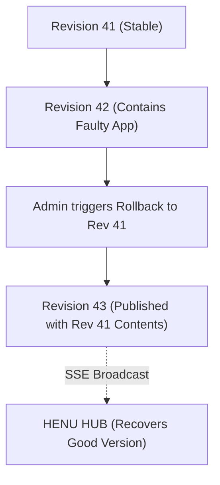

# HENU App Catalog & Publishing Guide

The **HENU App Catalog** is the public application manifest consumed by desktop launchers, clients, and web portals. The **HENU Platform API** serves as the private system of record, compiling and publishing immutable catalogue revisions.

---

## 1. Schema & Public Manifest Structure

The public catalogue is governed by the JSON Schema (Draft 2020-12) located in `henu-app-catalog/schemas/catalogue-manifest.schema.json`.

### Top-Level Manifest Attributes

```json
{
  "$schema": "https://henuos.com/schemas/catalogue-manifest.schema.json",
  "schemaVersion": "1.0.0",
  "revision": 43,
  "generatedAt": "2026-11-19T12:00:00Z",
  "contentHash": "sha256:7b91d3e8e2fa5342db6218d6a8b79e2f5b66dcfb4b8a1c97a89e1b2f3c4d5e6a",
  "publisher": {
    "name": "HENU OS PRIVATE LIMITED",
    "url": "https://henuos.com",
    "supportEmail": "support@henuos.com"
  },
  "catalogueSummary": {
    "totalApplications": 5,
    "channels": ["stable", "beta", "nightly"]
  },
  "applications": [/* Array of ApplicationManifest */]
}
```

---

## 2. Publishing a Catalogue Revision

When an administrator approves releases or changes application metadata, these changes remain in a **pending staging state** until explicitly published:

1. In the **HENU Admin Panel**, go to **Catalogue &rarr; Preview** (`/catalogue/preview`) to inspect the pending JSON manifest.
2. Verify that:
   - Approved applications are present with verified package URLs and SHA-256 digests.
   - Deprecated or hidden applications have their status set appropriately.
   - No private tokens or internal database IDs are exposed.
3. Navigate to **Catalogue &rarr; Publishing** (`/catalogue/publish`).
4. Enter an optional change summary (e.g., `Publishing HENU PA v1.0.0 and HENU AI v2.4.0 update`).
5. Click **Publish Revision**:
   - The Platform API increments the revision counter (`revision: N + 1`).
   - Calculates the canonical SHA-256 `contentHash` of the manifest body.
   - Stores the revision snapshot in PostgreSQL (`CatalogueRevision` table).
   - Generates a new HTTP `ETag` (e.g. `W/"rev-43-7b91d3e8"`).
   - Broadcasts the `catalogue:updated` event to all connected HENU HUB clients via Server-Sent Events (SSE).

---

## 3. Catalogue Rollback

If a newly published revision contains a critical bug, regression, or flawed package, administrators can trigger an **immediate, non-destructive rollback**:



### Rollback Procedure

1. Navigate to **Catalogue &rarr; Rollback** (`/catalogue/rollback`).
2. Review the list of previous revisions from the revision ledger.
3. Select the target healthy revision (e.g., `Revision 41`).
4. Click **Rollback to This Revision**.
5. **How Rollback Operates Internally**:
   - The system does **not** erase or mutate history.
   - It clones the verified manifest payload of Revision 41.
   - Publishes it as **Revision 43** (preserving strict monotonicity).
   - Updates the content hash and ETag.
   - Broadcasts `catalogue:updated` via SSE.
6. Connected HENU HUB instances immediately revert their local cache to the healthy application releases.
