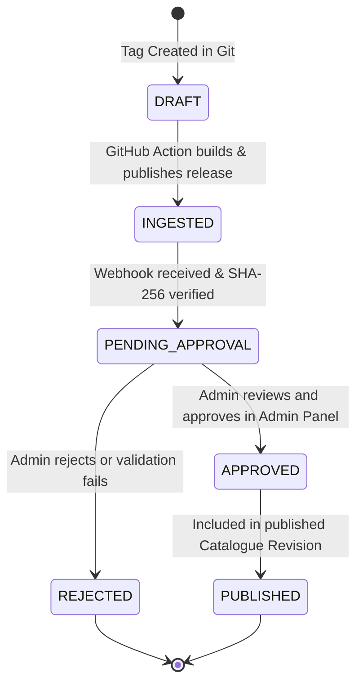

# HENU Product Release Guide

This guide establishes the official release lifecycle, package naming conventions, cryptographic verification standards, release state machine, and format-specific packaging procedures across all HENU software repositories.

---

## 1. The HENU Release Contract

Every supported product release must fulfill the complete release contract defined in `henu-common-actions`:

1. **Product ID**: Kebab-case identifier registered in HENU Admin (e.g. `henu-pa`).
2. **Semantic Version**: Valid SemVer 2.0.0 (e.g. `1.0.0`, `1.1.0-beta.1`).
3. **Release Channel**: `stable`, `beta`, or `nightly`.
4. **OS & Architecture**: Clear mapping for each binary (`windows-x64`, `macos-universal`, `linux-x86_64`).
5. **Installable Packages**: Supported packaging format (`msi`, `exe`, `dmg`, `pkg`, `deb`, `appimage`, `tar.gz`, `zip`).
6. **SHA-256 Checksums**: Cryptographic hash for every asset and an accompanying `SHA256SUMS` file.
7. **Release Notes**: Structured Markdown describing changes, improvements, and fixes.
8. **Minimum HUB Version**: Supported launcher version constraint.

---

## 2. Release Asset Naming Conventions

To guarantee deterministic matching across the Platform API, GitHub App, and HENU HUB, binary assets must follow this naming convention:

```
{productId}-{version}-{os}-{arch}.{format}
```

### Examples

| Product      | Target OS | CPU Arch  | Package Format | Compliant File Name                   |
| :----------- | :-------- | :-------- | :------------- | :------------------------------------ |
| **HENU PA**  | Windows   | x86_64    | MSI            | `henu-pa-1.0.0-windows-x64.msi`       |
| **HENU PA**  | macOS     | Universal | DMG            | `henu-pa-1.0.0-macos-universal.dmg`   |
| **HENU PA**  | Linux     | x86_64    | AppImage       | `henu-pa-1.0.0-linux-x86_64.AppImage` |
| **HENU AI**  | Windows   | x86_64    | EXE            | `henu-ai-2.4.0-windows-x64.exe`       |
| **HENU AI**  | macOS     | Universal | PKG            | `henu-ai-2.4.0-macos-universal.pkg`   |
| **HENU AI**  | Linux     | x86_64    | DEB            | `henu-ai-2.4.0-linux-x86_64.deb`      |
| **HENU IDE** | Windows   | x86_64    | ZIP            | `henu-ide-3.1.2-windows-x64.zip`      |
| **HENU IDE** | macOS     | Universal | DMG            | `henu-ide-3.1.2-macos-universal.dmg`  |
| **HENU IDE** | Linux     | x86_64    | TAR.GZ         | `henu-ide-3.1.2-linux-x86_64.tar.gz`  |

---

## 3. Release Lifecycle State Machine



### State Definitions

- **`DRAFT`**: Release tag pushed; packages being compiled and signed in GitHub Actions.
- **`INGESTED`**: GitHub Release published; webhook received by `henu-platform-api`.
- **`PENDING_APPROVAL`**: Platform API has streamed each asset binary from GitHub, computed and validated its SHA-256 digest, and queued it for administrative review.
- **`APPROVED`**: A Release Manager has reviewed the release in `henu-addplo` and marked it ready for distribution.
- **`REJECTED`**: Validation failed (e.g. missing platform packages, corrupted binary, pre-release version targeting stable).
- **`PUBLISHED`**: Included in a published catalogue revision; live in HENU HUB.

---

## 4. Package Verification Standards

### Cryptographic Digest Generation

Packages must never be published without generating streaming SHA-256 digests. `henu-common-actions` runs:

```bash
node scripts/generate-checksums.js ./release-assets SHA256SUMS
```

This produces a verifiable `SHA256SUMS` file:

```
e3b0c44298fc1c149afbf4c8996fb92427ae41e4649b934ca495991b7852b855  henu-pa-1.0.0-windows-x64.msi
e3b0c44298fc1c149afbf4c8996fb92427ae41e4649b934ca495991b7852b855  henu-pa-1.0.0-macos-universal.dmg
e3b0c44298fc1c149afbf4c8996fb92427ae41e4649b934ca495991b7852b855  henu-pa-1.0.0-linux-x86_64.AppImage
```

### SLSA Build Attestation

Workflows invoke `actions/attest-build-provenance` to record cryptographically signed OIDC attestations linking the build artifacts to the exact commit SHA and repository.

---

## 5. End-to-End Release Pipeline Walkthrough

### Step 1: Developer Creates a Version Tag

Product engineers tag a verified release commit following standard Semantic Versioning:

```bash
git checkout main
git pull origin main
git tag -a v1.0.0 -m "Release v1.0.0: Stable enterprise release"
git push origin v1.0.0
```

### Step 2: GitHub Actions Multi-Platform Compilation

Pushing tag `v*.*.*` automatically triggers the product repository's release workflow (inheriting from `henu-common-actions/.github/workflows/reusable-release.yml`):

1. **Matrix Runners**: Spawns GitHub-hosted runners (`windows-latest`, `macos-latest`, `ubuntu-latest`).
2. **Native Compilation**: Compiles the code (e.g., Tauri, Electron, or Go/Rust binary).
3. **Packaging**: Generates native installers and portable archives.
4. **Digest Calculation**: Streams file bytes through Node crypto to generate `SHA256SUMS`.
5. **Attestation**: Cryptographically signs artifacts via GitHub OIDC.

### Step 3: Release Artifacts Upload to GitHub Release

The workflow creates a published GitHub Release on `https://github.com/henu-os/{repo}/releases/tag/v1.0.0` attaching:

- Native binaries (e.g., `.msi`, `.dmg`, `.AppImage`)
- `release-manifest.json`
- `SHA256SUMS`
- Markdown release notes

### Step 4: HENU Platform Webhook Ingestion

Upon release publication, GitHub emits a `release` webhook event with `action: published` to:
`POST https://api.henuos.in/api/v1/webhooks/github`

The platform API performs security checks:

1. Validates the `X-Hub-Signature-256` HMAC against `GITHUB_WEBHOOK_SECRET`.
2. Checks idempotency using `X-GitHub-Delivery` GUID.
3. Maps the GitHub repository to the registered Application.

### Step 5: Platform API Validation

The API background job:

1. Downloads and inspects `release-manifest.json`.
2. Confirms version compatibility against existing versions.
3. Streams each binary from GitHub and recalculates its SHA-256 checksum to verify integrity.
4. Marks assets as `VERIFIED` and sets release status to `PENDING_APPROVAL`.

### Step 6: HENU Admin Review & Gatekeeper

Release Managers log in to HENU Admin (`http://localhost:3001`):

1. Navigate to **Releases** (`/releases`) and click on the new release.
2. Review target version, changelog, target platforms, and verified checksums.
3. Click **Approve Release** or select a channel for promotion (`STABLE`, `BETA`, `NIGHTLY`).

### Step 7: Catalogue Publishing

1. In HENU Admin, navigate to **Catalogue Publishing** (`/catalogue/publish`).
2. Pre-flight checks verify that every approved application has valid download URLs and signatures.
3. Administrator clicks **Publish Catalogue Revision**.
4. A new immutable revision is committed with a unique revision number and cryptographic hash.
5. The API dispatches an SSE event (`catalogue.updated`) to all connected HUB clients.

### Step 8: HENU HUB Detection and Installation

1. Desktop clients receive the live SSE event or poll `GET /api/v1/hub/catalogue` with `If-None-Match`.
2. HUB detects the new version and updates the application card state to `Update Available`.
3. When the user clicks **Update / Install**:
   - Downloads the platform-specific package with progress streaming.
   - Computes local SHA-256 checksum and compares with catalogue hash.
   - If hash matches, executes the native installer or unpacks the package.
   - Launches application safely once verification passes.

---

## 6. Format-Specific Packaging Guidance

### Windows Packages

- **EXE Setup Installer**:
  - Packaging Tool: NSIS (Nullsoft Scriptable Install System) or Inno Setup.
  - Typical naming: `henu-{app}-{version}-windows-x64.exe`
  - Silent Installation Argument: `/S`
  - Uninstaller registration: Windows Registry `HKLM\Software\Microsoft\Windows\CurrentVersion\Uninstall`
- **MSI Windows Installer**:
  - Packaging Tool: WiX Toolset.
  - Typical naming: `henu-{app}-{version}-windows-x64.msi`
  - Silent Installation Argument: `msiexec /i <package.msi> /qn /norestart`
  - Ideal for enterprise Group Policy (GPO) and Active Directory deployments.
- **ZIP Portable Archive**:
  - Typical naming: `henu-{app}-{version}-windows-x64.zip`
  - Unpacked into `%LOCALAPPDATA%\Programs\{app}` without requiring administrator elevation.

### macOS Packages

- **DMG Disk Image**:
  - Packaging Tool: `create-dmg` or native `hdiutil`.
  - Typical naming: `henu-{app}-{version}-macos-universal.dmg`
  - Contains `.app` bundle with drag-and-drop link to `/Applications`.
  - Mounted via `hdiutil attach`, copied, and unmounted.
- **PKG Installer Package**:
  - Packaging Tool: `pkgbuild` and `productbuild`.
  - Typical naming: `henu-{app}-{version}-macos-universal.pkg`
  - Installed via `sudo installer -pkg <package.pkg> -target /`.
- **ZIP Archive**:
  - Typical naming: `henu-{app}-{version}-macos-universal.zip`
  - Clean zip containing the signed and notarized `.app` bundle.

### Linux Packages

- **AppImage**:
  - Packaging Tool: `appimagetool`.
  - Typical naming: `henu-{app}-{version}-linux-x86_64.AppImage`
  - Standalone executable containing all bundled runtime dependencies.
  - Made executable via `chmod +x` and executed directly.
- **DEB Debian/Ubuntu Package**:
  - Packaging Tool: `dpkg-deb` or `cargo-deb`.
  - Typical naming: `henu-{app}-{version}-linux-x86_64.deb`
  - Installed via `sudo dpkg -i <package.deb>` or `apt install`.
- **TAR.GZ Linux Tarball**:
  - Packaging Tool: standard GNU `tar`.
  - Typical naming: `henu-{app}-{version}-linux-x86_64.tar.gz`
  - Portable archive extracted into `/opt/{app}` or `~/.local/share/{app}`.

### Web Applications

- **Hosted Cloud Application**:
  - Type: Cloud-hosted single-page application (SPA) or server-rendered web service.
  - Deployment: Continuous deployment via Vercel, Netlify, or AWS CloudFront.
  - Packaging: No binary installer required. The release manifest provides the canonical HTTPS browser URL (`webAppUrl`).
  - HENU HUB behavior: Renders an active **Launch Web App** button that launches the application in the system's default browser or embedded container.

---

_Copyright &copy; 2026 HENU OS PRIVATE LIMITED. All rights reserved._
