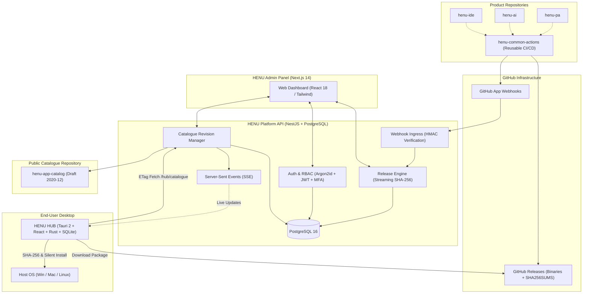

# HENU Platform System Architecture

This document outlines the high-level architecture, component topology, trust boundaries, and end-to-end data pipelines for the **HENU Operating System** application ecosystem.

---

## 1. Component Topology

The platform comprises six repositories operating as a coordinated, loosely-coupled distributed system:

---

## 2. Repository Responsibilities

| Repository                                                                  | Tech Stack                                     | Role & Scope                                                                                                                                                                                  |
| :-------------------------------------------------------------------------- | :--------------------------------------------- | :-------------------------------------------------------------------------------------------------------------------------------------------------------------------------------------------- |
| **[`henu-platform-api`](https://github.com/henu-os/henu-platform-api)**     | NestJS, TypeScript, PostgreSQL, Prisma, Redis  | Source of truth backend: authentication, RBAC, application inventory, GitHub App integration, release validation state machine, catalogue revision publishing, and live SSE event broadcasts. |
| **[`henu-addplo`](https://github.com/henu-os/henu-addplo)**                 | Next.js 14, React 18, Tailwind CSS, TypeScript | Secure administrative interface: app registration, repository connections, release approvals, rollback controls, audit log viewer, and user management.                                       |
| **[`henu-hub`](https://github.com/henu-os/henu-hub)**                       | Tauri 2, React 18, TypeScript, Rust, SQLite    | Cross-platform client application manager: dynamic catalogue discovery, package downloading, cryptographic integrity verification, running-app protection, and lifecycle orchestration.       |
| **[`henu-app-catalog`](https://github.com/henu-os/henu-app-catalog)**       | JSON Schema 2020-12, TypeScript                | Public manifest specification: immutable catalogue revisions, manifest hashing, content integrity validation, and rollbacks.                                                                  |
| **[`henu-common-actions`](https://github.com/henu-os/henu-common-actions)** | GitHub Actions, Node.js, Shell                 | Centralized CI/CD: reusable build workflows for Windows, macOS, and Linux, SHA-256 generation, SLSA provenance attestations, and webhook notifications.                                       |
| **[`henu-hub-docs`](https://github.com/henu-os/henu-hub-docs)**             | Markdown, Mermaid                              | Central technical, architectural, operational, and deployment reference across all ecosystem components.                                                                                      |

---

## 3. End-to-End Data Pipeline

### Release Authoring & Ingestion

1. **Packaging**: Independent product repositories build binaries via `henu-common-actions`.
2. **Attestation & Hashing**: All binaries receive cryptographic SHA-256 digests and SLSA build attestations before publication to GitHub Releases.
3. **Webhook Ingestion**: GitHub publishes a `release` webhook event signed with HMAC-SHA256.
4. **Verification**: `henu-platform-api` validates the signature, streams asset bytes to verify SHA-256 checksums, and records the release in `PENDING_APPROVAL` status.
5. **Approval**: Release Managers approve the release in `henu-addplo`.

### Catalogue Publication & Client Synchronization

1. **Revision Publication**: The Admin publishes a new immutable catalogue revision with content hashes.
2. **SSE Broadcast**: `henu-platform-api` broadcasts a `catalogue:updated` event to connected clients.
3. **ETag Fetch**: `henu-hub` requests `/hub/catalogue` with `If-None-Match`. If unmodified, `304` is returned; otherwise, the new manifest is downloaded and saved to the local SQLite database.
4. **Zero-Rebuild Discovery**: New applications and channels appear immediately in HENU HUB without recompiling or redeploying the launcher binary.

---

## 4. Trust Boundaries & Security Model

- **Private Admin vs. Public Catalogue**: Private administration data, API keys, and admin tokens remain exclusively within `henu-platform-api` behind Argon2id + TOTP MFA authentication.
- **Client Zero-Trust**: `henu-hub` never executes arbitrary remote commands; all actions flow through strictly typed, sandboxed OS platform adapters.
- **Integrity Validation**: Packages must match their declared SHA-256 digest before native execution is permitted.
